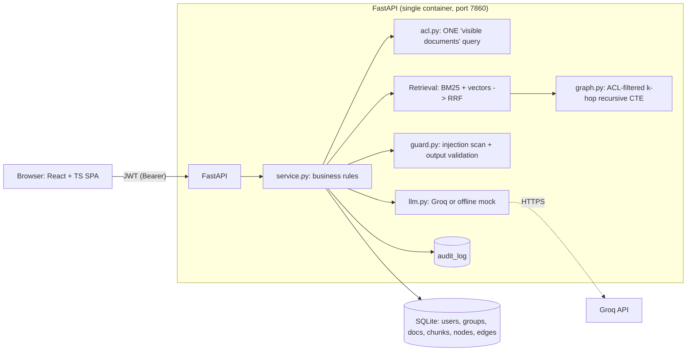

# VaultGraph — permission-aware GraphRAG

Upload documents, build a knowledge graph from them, and ask questions. Answers are generated from a **subgraph the asker is allowed to see**:
authorization is enforced inside the retrieval and graph-traversal queries, not in the prompt. The system is attack-tested (ACL-leak and
prompt-injection suites) and every answer is audited.

> The *Front matter* block above is only for Hugging Face Spaces; delete it if you just host the repo on GitHub.

## The product (what you see in the browser)

| Screen | What it does |
|---|---|
| **Sign in / Create workspace** | JWT login; self-service workspace creation (you become admin of an isolated tenant). In demo mode, one-click personas (Admin, Engineering, Finance, HR, Intern). |
| **Overview** | Document counts and processing state, your recent questions, system status (LLM provider/model + live health, embedder, storage note), admin activity feed. |
| **Ask** | Chat over your documents with clickable `[c12]` citation chips, source cards with document titles/snippets, "via graph" tags, graph relationships used, output-validator warnings, loading skeletons and clear errors. |
| **Documents** | Upload PDF/TXT/MD or paste text, set a title, choose which groups may find it (default-deny), watch processing status, see quarantined chunks. |
| **Knowledge graph** | Interactive SVG graph (pan, zoom, search, hover-highlight). Click an entity to load its ACL-filtered neighbourhood with the source document and passage behind every edge. |
| **People & groups** *(admin)* | Create people and groups, edit group membership (takes effect immediately). |
| **Audit log** *(admin)* | Timestamped actor/action/detail table with filters and expandable raw JSON. |

Responsive (sidebar collapses to a drawer on mobile). No screenshots are committed: run the app and capture your own into `docs/`.

## Architecture



```
upload -> chunk -> injection scan -> embed (hash | bge) -> extract triples -> nodes/edges (+ provenance chunk)
query  -> ACL-filtered BM25 + vector search -> RRF -> seed entities -> ACL-filtered k-hop walk
       -> nonce-delimited context -> LLM -> output validation (canary, URLs, images, citations) -> answer + sources + audit row
```

**Key design choice:** a node/edge is visible only if the chunk that is its *evidence* sits in a document the user can see. Restricted facts therefore
cannot be reached through an allowed neighbour (the classic GraphRAG leak), and there is no second ACL copy to drift.

## Stack (all free)
Python 3.11+ · FastAPI · SQLite · PyJWT + scrypt · NumPy · pypdf · Groq (free tier) · optional sentence-transformers (BGE) ·
React 19 · TypeScript · Vite · lucide-react · plain CSS · Docker · GitHub Actions · Hugging Face Spaces.

## Repository layout
```
vaultgraph/            backend (api, service, acl, graph, search, guard, llm, embeddings, uploads, config, demo)
frontend/              React + TypeScript + Vite SPA (src/pages, src/components, src/lib)
tests/                 Python tests (core, features, API)        frontend/src/lib/*.test.ts  (node:test)
eval/                  recall / leak / injection evaluation -> eval/RESULTS.md
Dockerfile             multi-stage: build frontend, then Python runtime serving API + static files
STUDY_GUIDE.md · THREAT_MODEL.md
```

## Local development

```bash
# 1) backend
python3 -m venv .venv && source .venv/bin/activate
pip install -r requirements-dev.txt
cp .env.example .env            # optional; add GROQ_API_KEY here. Without JWT_SECRET a random dev secret is generated per run.
python -m vaultgraph.demo --force      # optional: seeds the demo org (Northwind Labs) with the public demo password
uvicorn vaultgraph.api:app --reload    # API + Swagger on http://127.0.0.1:8000/docs

# 2) frontend (second terminal)       Node >= 20.19 (22 recommended)
cd frontend
npm install
npm run dev                            # http://localhost:5173 ; proxies API calls to :8000 (no CORS needed)
```
Single-origin run (what production does): `cd frontend && npm run build`, then run uvicorn; open http://127.0.0.1:8000 .
Set `DEMO_MODE=true` in `.env` to auto-seed on startup and show one-click demo logins on the sign-in page.

## Configuration

| Variable | Default | Purpose |
|---|---|---|
| `ENV` | `development` | `production` **refuses to start** without a strong `JWT_SECRET` |
| `JWT_SECRET` | random in dev | ≥ 32 chars in production |
| `GROQ_API_KEY` | – | Enables Groq. Stays on the server; never sent to the browser |
| `GROQ_MODEL` | `openai/gpt-oss-120b` | Verified against Groq's live model list on `/status` |
| `LLM_PROVIDER` | `auto` | `auto` / `groq` (error if no key) / `mock` |
| `EMBEDDER` | `hash` | `hash` or `bge` |
| `VAULTGRAPH_DB` | `vaultgraph.db` | SQLite path |
| `ALLOW_REGISTRATION` / `MAX_ORGS` | `true` / `200` | Sign-up controls |
| `DEMO_MODE` / `DEMO_PASSWORD` | `false` | Public sandbox accounts (never for real data) |
| `CORS_ORIGINS` | empty | Same-origin only by default |
| `MAX_UPLOAD_BYTES`, `MAX_PDF_PAGES` | 2 MB, 100 | Upload limits |

Full list with comments: `.env.example`.

### Groq
1. Create a free key at https://console.groq.com/keys. 2. Put it in `.env` (`GROQ_API_KEY=...`) or in your host's secret store. 3. Restart.
The sidebar pill and Overview → System status show the active provider/model and whether Groq accepts the model id.
Groq retires models regularly (`llama-3.3-70b-versatile` was shut down on 2026-08-16). If the model disappears, `/status` tells you and lists current ids;
change `GROQ_MODEL`. Without a key the app runs on an **offline extractive mock** (good for development; it cannot reason across hops, so use Groq for real demos).
Errors (invalid key, 404 model, rate limit, network) are mapped to readable messages and never include the key.

### Better embeddings (optional)
```bash
pip install -r requirements-bge.txt     # pulls PyTorch (large)
EMBEDDER=bge uvicorn vaultgraph.api:app
python -m vaultgraph.reindex            # re-embed chunks created with another model
```
Each chunk records the embedder that produced its vector; vector search only compares like with like, so mixed indexes degrade to BM25 instead of returning nonsense.
If the dependency or model is missing, the app falls back to hashing and `/status` says so. Docker: `docker build --build-arg INSTALL_BGE=true .` (large image; the model downloads on first use).

## Tests
```bash
python -m pytest -q                       # backend: core + features + HTTP (HTTP tests need fastapi/httpx from requirements-dev.txt)
python -m eval.run_eval                   # writes eval/RESULTS.md
cd frontend && npm run typecheck && npm test && npm run build
```
Backend tests cover auth, ACL enforcement, graph-leak regression, cross-tenant isolation, group management, uploads (type/size/magic bytes), injection defenses, LLM error handling,
production-secret enforcement, embedder fallback and DB migration. Frontend tests (`node --test`, Node ≥ 22) cover the API client (auth header, 401 handling, error mapping, multipart),
citation parsing, graph layout and audit formatting. **There are no browser/component tests yet** (see limitations).

## Docker
```bash
cp .env.example .env     # set JWT_SECRET (required: the image runs ENV=production); optional GROQ_API_KEY, DEMO_MODE=true
docker build -t vaultgraph .
docker run --rm -p 7860:7860 --env-file .env vaultgraph      # http://localhost:7860
# or: docker compose up --build
```

## Deploy on Hugging Face Spaces (free, Docker)
1. Create a Space at https://huggingface.co/new-space → **SDK: Docker**, blank template, public.
2. Push this repo to it (the front matter at the top of this README configures `sdk: docker` and `app_port: 7860`):
   ```bash
   git remote add space https://huggingface.co/spaces/<your-username>/vaultgraph
   git push space main        # use a Hugging Face access token (write) as the password
   ```
3. Space → **Settings → Variables and secrets**:
   - Secret `JWT_SECRET` = output of `python -c "import secrets; print(secrets.token_urlsafe(48))"` (**required**, otherwise the app refuses to boot in production mode)
   - Secret `GROQ_API_KEY` = your Groq key (recommended: the offline mock cannot do multi-hop reasoning)
   - Variable `DEMO_MODE` = `true` (showcase: seeds the fictional company and shows one-click logins) · optional `GROQ_MODEL`, `MAX_ORGS`
4. Wait for the build (a few minutes), open `https://<user>-vaultgraph.hf.space`. Check `/health`, then sign in as a demo persona and try the example questions.

**Persistence:** Space containers have ephemeral disk. SQLite lives in `/tmp`, so users, documents and the graph are **wiped on every restart/redeploy/sleep-wake**; demo mode reseeds automatically.
Free Spaces sleep when idle (cold start ≈ 30–60 s). Do not store real data on this deployment.
For production use: managed Postgres (pgvector/FTS), object storage for originals, Redis for rate limits/queue, token revocation, TLS-terminating proxy, backups.

## Security summary (details in THREAT_MODEL.md)
Default-deny document ACLs enforced in SQL · provenance-derived graph visibility · tenant isolation on every query · scrypt + pinned-alg JWT with role re-read per request ·
strict production config (no default secrets, no default admin; demo accounts only with `DEMO_MODE`) · upload allow-list + magic-byte + size/page caps ·
injection scan (zero-width, look-alike letters, letter-spacing, leetspeak normalisation) with quarantine · nonce-delimited context · output validation (canary, foreign URLs, markdown images, citation check) ·
CSP/nosniff/no-referrer headers, same-origin only CORS · generic 500s with a reference id · rate limits · audit log of queries, logins, admin actions and defence events.

## Known limitations (honest list)
- Prompt-injection detection is heuristic. Paraphrased or non-English instructions can evade it (`test_known_residual_gap`); ACLs bound the blast radius but do not stop a hijacked answer's *wording*.
- The evaluation set is tiny and handcrafted; injection results use a *simulated* gullible model. Re-run with Groq and add HotpotQA/MuSiQue before quoting numbers.
- Rule-based extraction understands a fixed set of sentence patterns; LLM-based extraction is the next step.
- SQLite + in-process BM25 suit demo scale (≈ 10⁵ chunks). Rate limiter is in-memory (single process). JWTs cannot be revoked before expiry (60 min); logout clears the browser token only.
- Token storage is `sessionStorage` (cleared when the tab closes). An HttpOnly cookie would resist XSS token theft but needs CSRF protection and fits poorly inside the Hugging Face iframe.
- No document deletion/versioning UI, no password reset, no email verification, no OCR for scanned PDFs.
- Admins can read every document in their workspace by design.
